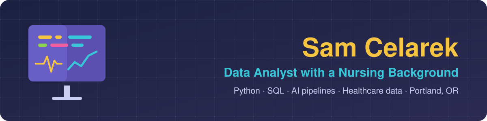

   

## Hi, I'm Sam

Data analyst with a nursing background, based in Portland, Oregon. I build end-to-end data tools with Python, SQL, APIs and AI, and I measure what they change.

- **3M+ IVF cycles** in the database I built as founding data analyst at [Baby Steps IVF](https://www.makebabysteps.com/), linking SART and CDC records and each clinic's pricing, insurance, doctors and services
- **30 → 1 minute** to prep each government RFP lead, with an 18-step Python and SQL pipeline I built at Nerevu Group
- **41% fewer** central line infections after a hospital quality improvement rollout I led as council chair

---

## What I've built

**[Baby Steps IVF](https://scelarek.github.io/pages/babysteps.html)** (2023 – present)
The data platform and models behind a site that compares 400+ US fertility clinics across 3M+ IVF cycles.

- **Database & ETL:** built the database from SART and CDC outcomes and scaled it into a multi-table resource with each clinic's pricing, insurance, doctors, services and locations. A 50-step Python and SQL pipeline (Polars, DuckDB, PostgreSQL on Supabase) runs the weekly refresh. I'm now piloting Dagster for orchestration.
- **Data quality:** linked clinic records across rebrands, mergers and duplicate registrations, with every match decision logged. Pandera schema checks run on each table write, the prediction API validates inputs with Pydantic, and pytest runs in GitHub Actions CI on every change.
- **Analysis & modeling:** EDA across 28 years of registry data, then Bayesian hierarchical models (PyMC) of each stage from egg retrieval to live birth, adjusted for patient age and case mix and validated on held-out 2023–24 data.
- **Causal analysis:** designed the causal framework for separating a clinic's own effect from the patients it treats, using a causal DAG, an instrumental-variable feasibility study and negative-control checks.
- **Automation:** review queues and an AI-assisted review hub resolve data questions, and recurring issues become automated rules.

**[Nerevu Group](https://scelarek.github.io/pages/nerevu.html)** (2023 – 2026)
Sole programmer on an internal 18-step pipeline (HigherGov, OpenAI, Airtable and Zapier APIs on Heroku) with LLM extraction and 900+ CI tests. Also maintained nightly SQL Server and SSIS loads for a mortgage-lending client, and produced charts and recommendations for a market disparity study and a municipal data governance report.

**[Nursing and quality improvement](https://scelarek.github.io/pages/quality.html)** (2014 – 2022)
Eight years as a nurse, five of them in neuro ICUs. Five years on a hospital Quality Improvement & Safety Council, rising from member to secretary, vice chair and chair. We used infection data, surveys and chart audits to find why line infections persisted, then led the fixes that cut them 41%.

---

## Tools

- **Data & SQL:** SQL Server / T-SQL, PostgreSQL, SSIS, DuckDB, SQLite, ETL pipelines, Pandera and Pydantic schemas, data validation and reconciliation
- **Analysis & modeling:** Python (pandas, Polars, scikit-learn), R, EDA, Bayesian hierarchical models (PyMC), causal inference, XGBoost, regression
- **Reporting:** Tableau, Power BI, Excel, dashboards and data visualization
- **Automation & AI:** REST APIs, LLM extraction and output scoring, Claude Code, GitHub Actions CI, pytest
- **Platforms:** Supabase, Airtable, Heroku, Modal, AWS, Azure, New Relic, Prometheus, Papertrail
- **From BrainStation class work:** TensorFlow, Keras, PyTorch, NLTK, Spark, Hadoop, Hive, GCP, Docker, time series forecasting (Prophet, pmdarima, darts)

---

## Earlier projects (BrainStation Data Science, 2023)

- **[COVIDCast](https://scelarek.github.io/pages/covid.html):** epidemiological and machine learning time series models to forecast new COVID cases
- **[SideBard](https://scelarek.github.io/pages/sidebard.html):** a chatbot that uses embedded search to help users navigate AI features in Google Workspace
- [Kickstarter funding prediction](https://scelarek.github.io/pages/kickstart.html) · [West Nile virus modeling](https://scelarek.github.io/pages/wnv.html) · [Hotel review sentiment](https://scelarek.github.io/pages/hotel.html) · [Google Ngrams with AWS](https://scelarek.github.io/pages/google.html)
- [ML reference guides and templates](https://scelarek.github.io/pages/reference.html)

---

**See more on my [portfolio](https://scelarek.github.io/)** · **[Email me](mailto:scelarek@gmail.com)** · **[Book a call](https://calendly.com/scelarek/60min)**

